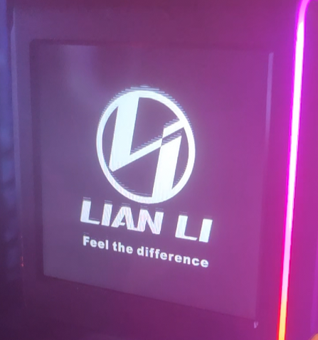

# R3 release qualification

Status: in progress. Starting source: `267fd8a` (R0–R2 complete).
The [R3 milestone](release-milestones.md#r3--qualify-and-cut-the-first-usable-lcdv2-release)
is the acceptance contract. This ledger does not substitute software checks for
installed-session or physical observations.

| Gate | Current state | Required completion |
|---|---|---|
| Exact production package | Production payload and Arch package built; four package unit tests, private install/upgrade/remove and packaged sensor/cooling GUI passed | Verify manifest/source/payload hashes, production features/notices; build package and run transaction and packaged-GUI checks |
| Remote CI | Private InkyQuill/ll-control created; first CI run 39060891301 is active | Publish authorized source to the selected repository and inspect actual CI result |
| Clean-host comparison | Local Docker endpoint unavailable | Provision an isolated build environment, record toolchain/dependencies and compare outputs; explain binary differences separately from deterministic repacking |
| Installed Plasma Wayland lifecycle | Current session is KDE Wayland; no installed daemon unit or running L-Connect process found | Install/upgrade/remove with retained data, udev access, tray/single instance/hide/show/exit and actual login autostart |
| Real input/accessibility | R1/R2 supporting tests exist | Actual compositor pointer/keyboard, fractional scaling, choosers and screen-reader speech |
| Hardware preflight | USB product reports LCDV2; this is not a firmware RPC or ownership audit | Establish current firmware/identity, single HID owner, backup, safe pump/source/RGB restore and fan wiring |
| Display and controls | [H.264 retest](#host-rotated-h264-retest): chart rotation passed at all four angles; brightness response observed; stable-display qualification blocked by a [cross-platform panel fault](#cross-platform-panel-fault) | Video/overlays/units, stop/replace, stale/recovery, operation after GUI close, stable LocalUI, cooling and RGB observations |
| Pump and RGB | [Duty, target RPM, Quiet/Performance and multiple pump/fan effects physically exercised](#pump-and-rgb-manual-run-2026-11-13). [Thermal trigger and recovery on both targets passed](#thermal-recovery-with-both-effects-saved) | Motherboard source, fallback/recovery, fan output/wiring, zone map, count/sync, animation continuity |
| Combined lifecycle | [Thirty-minute combined run completed; smooth motion confirmed in a separate high-contrast check](#installed-package-combined-soak); [installed daemon restart passed](#installed-daemon-restart)  and [sleep/wake passed](#installed-package-sleepwake)  and [reboot recovery passed](#installed-package-reboot)  and [cold boot passed](#installed-package-cold-boot); [software USB reconnect passed](#software-usb-reconnect) | Complete for the agreed lifecycle scenarios |
| Restoration and cutover | System service restarted; its journal reported LCDV2 open failure. Stable display restoration failed | Restore agreed cooling/RGB and LocalUI; publish accurate release notes/support table only after gates pass |

### Completed physical display checks on Galahad II LCDV2

- [x] LCD-013 rotation: 90°, 180°, 270° and return to 0° passed with host-rotated H.264.
- [x] LCD-012 brightness: blackout and visible intermediate response passed. Flicker limited fine comparisons between adjacent levels.

## Initial host inspection

Read-only inspection found KDE Plasma Wayland, Plasma/KWin 6.8.0, kernel
7.2.9-2-cachyos and WebKitGTK 2.54.1. USB discovery sees `0416:7395`; its product
string is not accepted as freshly read firmware. No daemon was started, no
hardware configuration was changed and no package was installed by this inspection.
Pavel confirms he is available for physical observations and expects fans to be
connected to the motherboard. LCDV2 fan output therefore remains unavailable
unless wiring is established otherwise. Pump restore settings remain unknown;
no cooling mutation is qualified by an assumed default. Firmware flashing is
outside R3.

## Evidence and repository policy

Raw build/run outputs remain in ignored `evidence/r3/` and private temporary
folders. Reproducible tools, fixes, plans and qualification summaries are tracked.
User-facing installation/use/help remains under `docs/user`; this technical
qualification ledger belongs to development documentation.

## GitHub publication

[Repository](https://github.com/InkyQuill/lconnect-linux) is private. At Pavel's
request, publication used a separate filtered copy: 421 historical evidence paths
were removed, while all 195 master commits and the current source tree were
preserved. Local history was not rewritten. Legacy implementation sources were
retained. The private commit map is retained with ignored evidence; historical
short hashes in documentation identify the original local lineage.

The published R3-ledger commit is `b701acc` (local `302ebe4`). Future commits must
be transferred to that cleaned lineage before pushing; do not merge unfiltered
local history into it. CI run39060891301 is the first actual remote execution,
not yet a passing result.

## Live preflight

One isolated daemon was started with an empty configuration after backing up the
existing configuration and confirming no HID owner. Firmware RPC returned1.6;
initial telemetry was pump2400RPM, coolant36.1°C and fan0RPM. No saved firmware
operation/guard was present. Cooling requested/applied state is unset in this
session. Old host configuration contains pump80% MCU and fan60%, but is historical
intent, not proof of the present device setting; it was not replayed.

The radial-gradient and strawberry replacement passed Pavel's physical
observation. A71.15-second sample series kept pump2400–2430RPM and maximum
telemetry age0.76s. Brightness/rotation FAILED physical acceptance: commands
reported success, but the image switched to the Lian Li logo and returned without
visible dimming/rotation. Source inspection shows JPEG configuration patches send
the requested LocalUI mode while the JPEG keeper remains active. Resolution and
physical retest are required; machine success does not close this gate.

Pavel authorized pump80% MCU and static-blue pump LEDs as restore settings.
The80→90→80 pump sequence completed with continuous telemetry and restored80;
fan controls were not changed. LCD was cleared to LocalUI after the failed test.
RGB restoration/qualification has not yet run.

The candidate was installed on the host through pacman. Its service remains
disabled/inactive; the isolated daemon is the sole device owner. The native
Wayland GUI initially failed with compositor error: explicit synchronization
without an acquire point. `WEBKIT_DISABLE_DMABUF_RENDERER=1` keeps it running;
Pavel confirms the window is visible/responsive. Default-launch resolution is
still required. This is a real target-session defect, not covered by Xvfb passes.

Packaged Mini checks passed using the retained private GJS runtime, including
Qt/model/GJS/preferences/read-only CLI and private Plasma host. `/usr/bin/gjs`
was absent, so the initial invocation did not run tests; that failure is retained.

First remote Arch CI failed before tests: all-feature Rust checking enables
embedded frontend loading, but a fresh checkout has no desktop/build directory.
The workflow now builds the frontend before Rust checks. Local actionlint passed;
a remote rerun is required. Browser CI is still running.

## First target-session fixes — pending physical retest

JPEG/Theme settings now use the LCDSetting transaction instead of replaying
LocalUI. Configuration targets are explicit so replacement through Idle cannot
select the wrong mode; H264 retains host rotation and zero hardware rotation.
The regression first failed on actual mode bytes, then passed brightness/rotation,
continued image refresh and replacement at90°. All20 LCD-owner tests,42 actor
unit tests (one unrelated vendor-firmware case ignored),16 Screen-group and9
Screen-reset tests passed. Strict GUI/daemon all-target Clippy and fmt passed.
Visible rotation/brightness is still pending a rebuilt-daemon retest.

Production GUI startup now re-executes with the confirmed WebKit compatibility
setting on NVIDIA Wayland unless the user explicitly sets the renderer variable.
It preserves arguments and leaves recording-worker dispatch first. The manual
workaround is visually accepted; automatic startup needs a production build test
with the variable unset. Rust review found a replacement transition risk, now
covered by an explicit configuration target and regression. R3 is not complete.

## Physical retest and editor feedback

The rebuilt daemon still failed the static JPEG rotation test: Pavel observed the
strawberry upright and apparently at full brightness despite requested30%/90°.
Do not close that defect based on the LCDSetting wire regression.

The video-background composition with CPU, CCD, GPU and coolant readings visibly
rotated and updated its values. Pavel could not distinguish30% from full
brightness. Setting0% then visibly darkened the screen;100% was subsequently
requested to restore visibility. This confirms a physical backlight response,
not intermediate brightness accuracy or static-JPEG rotation.

The installed composition editor passed Pavel's add/select/drag/resize/undo and
window-resize check at the current desktop scaling. Usability remains open:
make canvas editing the default, consolidate live preview, and replace the long
stack of expanded layer forms with compact navigation and selected-layer controls.
Pavel explicitly requested Impeccable polish; preserve explicit Apply.

The clean7fd3058 production package passed the packaged GUI sensor/cooling test
with MockBackend and no instrumentation. This is package verification, not
physical hardware acceptance. Remote Arch/browser CI remains pending.

## Manual LCD retest, 2026-11-13

Galahad II LCDV2 `0416:7395`, Linux `7.3.3-1-cachyos`, temporary HID-logging build of
`7e3bda531fbc65ce68e4e46000eaa1be0352763d`. The earlier bench session read FW 1.6;
the completed session did not query firmware. This qualifies observations on the
instrumented build. Exact release-package acceptance remains open. Private session
`20261113-132042-972062` contains `events.jsonl`, `hid.log` and `daemon.log`.
Times below are Moscow time. No raw serials or machine-specific logs are published.

| Scenario | Command and physical observation | Result |
|---|---|---|
| Static image ownership | The 12,657-byte TOP chart reached the LCD in 13 cmd 14 reports. It appeared with LocalUI flickering behind it. Explicit reload reproduced this. | Image transfer observed; stable display failed |
| Backlight | 0% black; 1% appeared black (inconclusive); 2% just visible. 5% visibly dimmer than 10%, 10% dimmer than 25%, 25% dimmer than 100%, and 75% brighter than 50%. Difference between 75% and 100% uncertain. The operator confirmed brightness response after the full sequence. | Visible intermediate control confirmed; no luminance calibration |
| Static JPEG orientation | First 90° request briefly blanked the screen before LocalUI appeared. On the later full sweep the device echoed cmd 12 settings for 180°, 270°, 0° and 90°. TOP stayed upright at 180°, 270° and 90°. Returning to 0° from an already upright image was inconclusive. | Failed at 90°/180°/270°; 0° transition unverified |
| Ownership change | First run detached and reattached with a different daemon device ID. One 180° trial ended before any write; a later trial actually sent 180°. At final shutdown the last settings write and echo were 100% / 90°. At 13:31:00 the installed service started and reported it could not open the LCDV2. The operator then saw LocalUI rotated 90° with the chart flickering behind it. | Service restart confirmed; successful HID reacquisition unverified; clean visual restoration failed |

Physical cooling, RGB, combined soak, cold boot, suspend/resume, deliberate USB
reconnect and exact-package qualification remain open. For the Windows comparison
and next controlled test see [static image rotation and display mode](../protocol/lcdv2-screen-pipeline-2.1.28.md#static-image-rotation-and-display-mode).

## Host-rotated H.264 retest

Private session `20261113-135910-230948`, November 13, 2026, candidate
`69e7df7956e2c009d5937a92cb4d32b31bf8d3d7` ([#38](https://github.com/InkyQuill/lconnect-linux/pull/38)).
The input was the same asymmetric TOP chart. Brightness stayed at 100% during the
angle sweep. The previous cmd 14 results above remain the baseline.

| Trial | Physical observation | Rotation | Stable display |
|---|---|---|---|
| Initial 0° | Chart appeared with LocalUI visible through it and heavy flicker | Initial position | Failed |
| 90° | Chart rotated correctly; LocalUI flicker still visible | Passed | Failed |
| 180° | Chart rotated correctly; LocalUI flicker still visible | Passed | Failed |
| 270° | Chart rotated correctly; LocalUI still visible and flickering | Passed | Failed |
| Return to 0° | Chart returned upright as intended | Passed | No separate flicker verdict on this transition |

The operator marked brightness 0–45% in five-point steps as working.
90% was inconclusive; flicker prevented distinguishing 45% from 50%.
The system service restart succeeded. No post-handoff visual verdict was recorded in this run.

Daemon counters stayed on generation 1 through the rotation sweep and brightness
tests. The last sample reported 5,727 frames in 245.376 seconds (23.34 fps),
zero failed frame transactions and 5,571 read timeouts. The raw HID log was empty
and all wire offsets were zero. Packet contents, device replies and the cause of
flicker are unverified for this run. Display stability remains open.

**Post-session reset check.** With the test daemon stopped and the installed service stopped first, one cmd 142 reset received a 64-byte acknowledgement. The device stayed enumerated throughout the 20-second watch. The restored service discovered the cooler but reported it could not open it. The operator confirmed LocalUI still flickered. The reset did not recover stable display; the cause remains unresolved.

### LocalUI edge artifact after streaming

The operator supplied this frame to identify the artifact seen by eye. Short bright horizontal strokes repeat along the top of the circular rim, the inner diagonal and the lettering. The still documents their shape; it cannot establish field order or interlacing.

In session `20261113-141252-741589`, the bench captured 535 H.264 frames over 22.9 seconds. After the test daemon exited, the chart lingered for about ten seconds before LocalUI returned and continued flickering. Both daemons were stopped for about 97 seconds. Restarting the installed service produced no visible change. The photograph is supplemental evidence; it has no synchronized HID timestamp.

### Cross-platform panel fault

Pavel observed a clean logo at power-on and through GRUB on an earlier boot, followed by flicker during Linux startup. He subsequently reproduced the same artifact under Windows. Reflashing the device and attempting a full power discharge did not clear it.

For R3, classify persistent LocalUI flicker as a probable hardware fault on this unit. The Windows reproduction shows the Linux daemon is unnecessary for the symptom. LIAN LI identifies possible LCD MOSFET damage for this symptom and recommends requesting a screen replacement. The failed component has not been independently identified. [GA II LCD FAQ](https://lian-li.com/faq/faq_galahad-ii-lcd/)

The observed four-angle rotation and brightness results stand. Stable-display acceptance remains open for a known-good or replacement screen.

### Pump and RGB manual run, 2026-11-13

Private session `20261113-151441-874792`, instrumented build `69e7df7`. Values below are measured pump RPM from fresh device snapshots (age under three seconds), starting five seconds after each Apply and ending at the next trial. Quiet and Performance used the same AMD GPU temperature sensor.

| Pump request | Applied MCU duty | Median RPM | Observed range | Samples |
|---|---:|---:|---:|---:|
| Fixed 80% | 80% | 3060 | 3060–3090 | 28 |
| Fixed 40% | 40% | 1740 | 1740–1950 | 15 |
| Target 2400 RPM | 60% | 2460 | 2460–2490 | 25 |
| Quiet | 55% | 2310 | 2310–2340 | 10 |
| Performance | 70% | 2790 | 2760–2790 | 47 |

Fixed duty response, RPM-target response and both preset responses were physically observed. Exact target tracking or full curve coverage was not demonstrated. Motherboard source, unavailable-sensor fallback/recovery and fan PWM remain open. The last snapshot showed 3030 pump RPM at restored 80% MCU and 0 fan RPM.

| Lighting trial | Applied vs observed |
|---|---|
| Pump, all LEDs | Static red, breathing, runway, meteor, static starry night and voice marked Works with no exception noted. |
| Pump animation continuity | Four-color ticker tape restarted before the second color finished at speed 75%; at 100% it ran faster and showed three colors before restarting. Four-color fluctuation showed only two colors. Transmit jumped halfway and colorful starry night jumped. Mode selection worked; complete animation cycles remain unqualified. During the 75% ticker trial the HID trace contains 46 pump-lighting cmd 131 writes in about 89 seconds, generally two seconds apart. Test whether periodic reapplication restarts animations. |
| Zones and fan sync | Inner and outer were sent; the two visible side tracks could not be mapped to those names. Changing pump lighting alone left fans rainbow. After fan configuration, operator reported that synced fans take the pump setting; sync-on trial marked inconclusive. Sync off allowed independent fan color (static cyan requested). Fan rainbow, meteor and runway marked Works; rainbow morph restarted early. Only 360 / 24 LEDs was configured; physical count and alternative topologies remain unverified. |
| Thermal override | First two 57°C attempts rejected because fan and pump lighting bases were not both known. After establishing both bases, the 60°C yellow rule was accepted for the CPU rule slot but bound to AMD GPU temp1. Operator saw no change while watching CPU temperature. All 75 subsequent trial samples reported no active thermal source. No recorded threshold crossing on the bound sensor; visible alert and return to base remain open. |
| Restore | Daemon accepted 80% MCU, cleared thermal rules, and static blue on pump/all and fan (sync off, 360 / 24). Operator noted RGB appeared saved after stop; final colors were not individually identified. Test daemon exited successfully. Previous system owner was inactive. |

### Pump ticker-tape retest

**Passed at 75% and 100% speed** on instrumented build `c3139aa` ([#39](https://github.com/InkyQuill/lconnect-linux/pull/39)), private session `20261113-185847-298433`. The operator confirmed all four configured colors (red, blue, green, yellow) appeared and the speed changed correctly. Pump scope was all LEDs, forward direction, 100% brightness.

| Trial in order | Observation window | Successful cmd 131 writes |
|---|---:|---:|
| 75% | 9.7 s | 1 |
| 100% | 16.2 s | 1 |
| 75% again | 36.7 s | 1 |

Counted raw HID output attempts beginning 01 83 and their write results from each Apply through the next trial boundary. Each window contained one attempt, completed with 64 bytes written, and zero repeats. Restoring static blue produced its own successful cmd 131 write after the last ticker window. The previous 75% trial had 46 writes in about 89 seconds and restarted partway through the palette. This closes the observed pump ticker-tape restart defect on this unit. The other discontinuous effects in the preceding run still need separate physical retests.

### Thermal override retest with k10temp Tctl

**Blocked before LED output.** In session `20261113-191421-344474`, both Apply requests selected the CPU rule slot, `k10temp: Tctl` (temp1), 60 °C and yellow (#ffff00). Tctl ranged from 54.875 to 67.875 °C. Both fan and pump lighting bases were null at startup. Both requests returned −32002 (“thermal alerts require known fan and pump lighting bases”). Telemetry showed no configured rule or active alert. The operator saw no LED change and the capture contained only 01 81 output attempts. Neither visible alert nor recovery was exercised.

Windows 2.1.28 service source: `TemperatureAlertController.evaluate/updateTriggerState` activates at or above threshold and restores when the last source clears. `Galahad2VisionController.ApplyThermalAlertOverrideAsync` applies static alert color to fan and pump-head LEDs without checking for two saved bases. `RestoreFromThermalAlertAsync` loads device settings and calls `ApplyAll`. Linux build `c3139aa` uses the same threshold comparison but rejects configuration with either base absent (`actor/thermal.rs`, `actor/lighting_keeper.rs`). This is a first-use parity gap. A physical trigger/recovery retest on this build requires applying a recognizable base to both lighting targets before enabling the rule.

### Thermal override trigger and recovery on Tctl

**Confirmed on hardware** with build `ec5e587`, session `20261113-192548-387940`. Both zones began with no saved effect. The 60 °C yellow CPU rule on `k10temp: Tctl` was accepted. On its first activation the daemon sent yellow to the fan (cmd 133) and inner pump LEDs (cmd 131). At the first clear (59.75 °C sampled) it resent both yellow packets unchanged. At 63.25 °C sampled the CPU alert was active again. Sensor and rule state are sampled separately.

After the operator applied a static blue pump base, explicitly clearing the 60 °C rule replayed blue on the pump and yellow on the fan. Later, under a **63 °C red** rule with a green breathing pump base, the 63.75 °C active sample and 62.875 °C clear sample bracketed red writes to both targets followed by green breathing on the pump and retained red on the fan. This repeated on subsequent crossings. The operator confirmed pump effect recovery and that the fan stayed the alert color. All 32 pump and 28 fan lighting writes in the session completed with 64 bytes.

This matches the Windows 2.1.28 restore path for the tested cases. The three manual lighting requests and the final lighting restore all targeted the pump. No fan effect request reached the daemon. The operator reported changing fan controls several times, but the log does not capture local edits or rejected clicks. Restoring a **saved fan effect** remains unverified.

### Thermal recovery with both effects saved

**Passed on the Galahad II LCDV2.** Session `20261113-193523-927080`, build `ec5e587`. Daemon readback confirmed green breathing on the fan (sync off) and red/blue runway on all pump LEDs. The CPU rule used `k10temp: Tctl`, a 63 °C threshold and static red.

Two alert/clear cycles occurred before teardown. The first showed active at 64.125 °C and clear at 60.875 °C. The second showed active at 63.875 °C and clear at 60.125 °C. In both cycles the HID log shows successful static red writes to fan (133) and pump (131), then replay of each target’s original effect packet on cooling. The operator confirmed both effects visibly resumed. This closes the saved-fan recovery case left open in the previous session.

### Installed package combined soak

Arch package `ll-control 0.1.0-1`, revision `5c2e354`, Galahad II LCDV2 firmware 1.6. The installed user service streamed a video background with live Tctl and clock overlays, ran the pump at 80%, and drove green breathing fan LEDs and red/blue runway pump LEDs. Over 1,800.016 seconds and 361 samples it sent 42,007 frames (23.34 fps), with zero failed frame transactions, 40,955 empty optional readbacks and at most one frame pending. All sampled temperatures were valid. Pump speed was 3,030–3,060 RPM, maximum snapshot age 714 ms (rounded up), snapshot RPC p95 2.35 ms, and peak daemon RSS growth after minute one 2.64 MiB.

The operator confirmed the clock advanced, Tctl tracked the motherboard display, and both RGB effects worked. The known panel flicker persisted and the dark background made its motion difficult to judge. In a separate follow-up on the same installed service, the operator confirmed a yellow bar swept smoothly across a blue background behind the live overlays. Afterward the daemon reported LocalUI applied and the LCD source idle.

### Installed daemon restart

**Passed** on installed package `0.1.0-1` (revision `5c2e354`). After a user-service restart the new daemon was the sole owner of the Galahad II LCDV2 (firmware 1.6). Readback matched the pre-restart settings: LocalUI at 0° and 100% brightness, green breathing fan LEDs, red/blue runway pump LEDs, and 80% pump duty. The post-restart sample was 3,030 RPM. The operator confirmed the LCD and both LED effects looked as before and noticed no jump or spike during the transition.

### Installed package sleep/wake

**Passed** on 2026-11-14 with the saved R3 lifecycle sweep theme. The system journal recorded suspend at 04:59:44 MSK and resume at 05:00:05. The operator saw the animation stop for sleep and resume automatically on wake. Post-wake readback showed the saved theme active, 2,310 frames sent and zero failed frame transactions.

### Installed package reboot

**Automatic recovery after reboot passed** on 2026-11-14. The boot ID changed. The last visible clock update was 05:08:23 MSK. Systemd started the enabled user service at 05:09:29, and the operator saw updates resume at 05:09:40 (77 seconds between displayed times, about 11 seconds after service start). Both the theme and lighting visibly recovered. Readback showed the saved theme active, fan breathing, pump runway, 3,030 pump RPM and 3,709 frames sent with zero failed frame transactions. The operator described a reboot; a full shutdown followed by power-on was not explicitly confirmed.

### Installed package cold boot

**Passed after full shutdown and power-on** on 2026-11-14. The operator saw the LCD clock stop at 05:14:37 MSK and resume at the login screen at 05:16:05, 88 seconds later. The boot ID changed and the installed user service started at 05:15:54, about 11 seconds before visible recovery. Readback confirmed the saved R3 lifecycle sweep theme active, 2,611 frames sent, zero failed frame transactions and 3,030 pump RPM. The daemon reported fan breathing and pump runway. The physical observation for this run was the LCD clock.

### Software USB reconnect

**Passed** on 2026-11-14 with the installed service streaming the R3 lifecycle sweep. Linux deauthorized only the cooler’s USB interfaces for five seconds, with the motherboard cable in place. The cooler disappeared from the daemon’s device list and reappeared at 05:19:48 MSK. The same daemon process resumed the saved theme and lighting. About eight seconds into playback it reported 184 frames sent, zero failed frame transactions, both lighting bases applied and 3,030 pump RPM at 80% duty.

The operator saw the display and RGB go black for a couple of seconds and return automatically, without an intervening LocalUI logo. The physical cable remained connected throughout.
