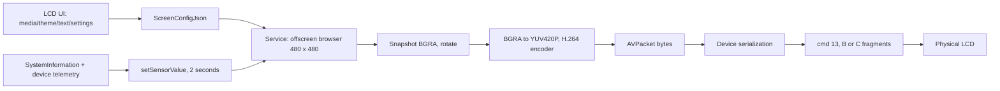

# LCDV2: screen pipeline L-Connect 3 2.1.28

Дата: 2026-09-08. Статус: static-reference verified, hardware streaming
ещё не проверен. Основной scope — `0416:7395`, не другие Galahad/HydroShift.

## Provenance и обозначения

Reference root: `/home/inky/Development/lian-li/reference-decompiled/2.1.28-2026-09-08`.
Все десять исходных assembly hashes повторно сверены с `manifest.json`.

| Alias | Путь относительно reference root | SHA-256 assembly |
|---|---|---|
| S | `L-Connect-Service/LConnectService/Products/Galahad2Vision/Galahad2VisionController.cs` | `c1563b43a3918928056de1fa6601099b49f58ae7e10804ed9634db6afa4f47f8` |
| E | `L-Connect-Service/LConnectService/WMSQLibAV.cs` | тот же Service hash |
| D | `L-Connect.Core/LConnectCore/Products/Galahad2Vision/Galahad2VisionDevice.cs` | `40e4bfc0d58c0732080f1c67d7f84a23324b36850fd14c0ed16d86a51d11ac9e` |
| C/B | `L-Connect.Core/LConnectCore/Products/Galahad2Vision/{C,B}CommandPacket.cs` | тот же Core hash |
| T | `L-Connect.Core/LConnectCore/NonOverlappingTimer.cs` | тот же Core hash |

Windows UI assembly: `2cdfa7ae3717dd773417cabb3338957f15ca29f5de46b5a77788b5e680cf4080`.
Полный каталог действий — [матрица](../parity/lcdv2-2.1.28-matrix.md).
Ссылки S/E/D ниже указывают на этот фиксированный export, не на старую декомпиляцию.

## Цепочка вывода



Сервис, а не окно настроек, владеет браузером и encoder. UI передаёт конфиг
композиции; sensor values обновляются независимо от preview. Windows-native
renderer — reference поведения, не требование переносить CefSharp на Linux.

### Config, assets и sensors

- S:836–858 сохраняет/применяет `ScreenConfigJson`; S:1130–1135 вызывает JS
  `setConfigs`. Browser создаётся с размером 480×480 и ждёт initial load
  (S:1088–1107).
- `LConnectApp.cs:373` связывает `AssetsWMSQDirectory` с `Assets/ga2v`.
  `ga2v/index.html:1` загружает `app.8fc94db7.js` (не соседний старый bundle).
  Его SHA-256: `f3691c15dbe62d1248abee444dc94c82a34c46e45697bda4ccad77825c6e878a`.
  Minified JS содержит `setConfigs`/`setSensorValue` и composition logic;
  bundle не копировался в Linux repo и целиком не reverse-engineered.
- S:952–1023 создаёт default JSON с image/video path, slider sensors и
  watermark. Это host-side composition, не аппаратная тема с таким же JSON.
- S:1199–1237 раз в 2 секунды передаёт CPU/GPU load/temperature, PumpRPM,
  RAMLoad, CPUPower, water temperature и units в `setSensorValue`.
  Подстановка 0 при отсутствии некоторых Windows sensors — поведение
  reference, которое не следует превращать в fake measurement в Linux.
- Preview читает host frame buffer через process memory (S:736); это не
  чтение framebuffer устройства и не подтверждение physical display.

### Захват, pixel format и encoder

| Параметр | Значение/поведение | Evidence |
|---|---|---|
| Canvas | 480×480 | S:1038–1039,1096 |
| Host buffer | 921600 bytes = 480×480×4 | S:214 |
| Capture target | 41.6667 ms, около 24 callbacks/s | S:212,1142–1154 |
| Input | BGRA, непрерывное копирование width×height×4 | E:42,108,125,209–216 |
| Conversion | swscale BGRA → YUV420P | E:125,219–223 |
| Codec | H.264; encoder выбран через codec ID | E:45–48 |
| Profile / level | baseline / 30 (3.0) | E:73–75 |
| Preset / CRF | ultrafast / 25 | E:76–77 |
| GOP | fps, то есть 24 при данном Init | E:62; S:1039 |
| time_base / framerate | 1/fps, fps/1 | E:63–72 |
| PTS | 0 при Init, +1 при EncodeImage | E:126,214 |
| Output unit | каждый ненулевой AVPacket, ровно packet->size bytes | E:229–241 |

S:1172–1184 копирует browser buffer под BitmapLock, затем выполняет rotation
и encode. Прямое копирование предполагает подходящий stride для 480px;
Linux input type должен явно определять contiguous BGRA layout, а не
распространять это предположение на произвольные изображения.

T:241–262 вычитает время callback из интервала; при медленном callback не
создаёт параллельные вызовы и не гарантирует 24 fps. Capture, encode и HID
связаны синхронным callback; большие кадры снижают actual rate.

E:223–241 прекращает обработку на send/receive error и отдаёт каждую
полученную packet отдельно. В inspected code нет собственного контейнера
или framing по NAL delimiter. H.264 NAL не равен кадру: SPS/PPS/SEI и slices
могут входить в один access unit. Linux transport должен получать готовые
packet/access-unit boundaries от encoder/parser, не резать stdout по read().

Точное encoder имя, Annex-B vs AVCC и вставка SPS/PPS не заданы явно этим
C# wrapper. Для Linux test source выбран отдельный воспроизводимый Annex-B
fixture; его совместимость с устройством проверяется spike, не предполагается.

### Wire transaction и ответы

- S:1249–1276 выбирает B `SendH264Frame` по умолчанию; FW >=1.5 переключает
  на C `SendH264Frame512` и включает LCD-availability polling.
- D:168–171 / 221–224: весь encoded packet передаётся как cmd 13 через B/C,
  после чего выполняется **одно** чтение до 512 bytes с timeout 20 ms.
- D:248–250 возвращает результат `HidDevice.Read`. В этих send methods
  результат игнорируется: reference не требует подтверждённого cmd echo
  или success status. Поэтому нельзя вводить обязательный echo-ACK только
  из-за существующего Rust `WriteRead512`.
- C:11–17: report 3, output/input 512, header 11, payload 501.
  B: соответствующий report 2, output 1024, input 512, payload 1013.
- C:30–79 и BuildPacketsForWrite: total size — BE u32, packet number —
  BE u24 начиная с 0, payload length — BE u16, tail zero-filled.
  Total size — размер одного encoder packet; packet number начинается заново
  для следующего packet. Поля не означают количество кадров или ID клипа.
- D:293–323 пишет fragments последовательно. S:1077–1084 и 1628–1643
  сериализует действие под device lock; не смешивает fragments двух кадров.
  Windows pending-I/O retry/error 997 — OS detail, не Linux protocol command.

Нужен hardware answer на вопрос, возвращает ли наш LCDV2 данные после
cmd 13, какого размера/report/echo и появляются ли запоздалые ответы.
Текущий Linux drain-for-echo не считать автоматически подходящим.

## Lifecycle

Важный setup path: S:793–807 `setScreenBrightness` отправляет cmd12 с
`Mode=LCDSetting` (4), brightness и `VideoFPS=24`. Core
`LCDControlSetting.cs:17–48` помещает FPS в восьмой byte payload (index7).
Это наблюдаемая Windows settings transaction, а не доказательство того,
что перед каждым stream обязательно включается Application mode.
Rust `LCDControlSetting::default()` имеет собственный FPS default; M1
должен задавать24 явно. `LCDSetting` остаётся внутренней операцией драйвера,
не разрешённым произвольным пользовательским mode RPC.

| Событие | Windows path | Linux requirement |
|---|---|---|
| Start | default config → encoder → browser → image timer → sensor timer, S:911–920 | Один активный источник на device |
| Stop | suppress send, остановить timers, dispose, S:923–931 | Не выдавать success пока старый источник ещё пишет |
| Reconfigure | JSON → setConfigs, S:836–858 | Управляемая замена без смешивания кадров |
| Stream reset | stop, bounded wait 10s, delay 1s, restart, S:934–949 | Собственный lifecycle с наблюдаемыми ошибками |
| Suspend | ignore sends, S:1307–1310 | Не накапливать кадры во сне |
| Resume | delay 3s, stream reset, S:1312–1315 | Reinitialize and start at decodable keyframe |
| Manual/error | device lock guard skips operations, S:1628–1633 | Firmware/manual ownership must exclude streaming |

H.264 P-frames зависят от предыдущих кадров. Произвольный latest-wins для
уже закодированных пакетов ломает reference chain. Минимальный M1 должен
backpressure без dropping внутри GOP, либо сбрасывать backlog до keyframe
вместе с явным decoder restart contract. Первый вариант проще для spike.

## Startup/offline: установленная граница исследования

Поиск `UploadJpeg|UploadAvi|UploadH264|UploadStartupAviMovie` во всех C#
Core/Service/UI дал объявления enum Galahad2Vision/HydroShiftLCD, но не
пользовательские callers этих имён. Дополнительно inspected D writeB/writeC
call sites: firmware, LCDControl, H.264, LEDs, availability; cmd 15/18/19/21/22
не найден. Это не доказательство отсутствия raw/numeric/SDK routes.
Необходим дальнейший UI/raw-reference trace при наличии соответствующего
действия; enum-only команды не включаются в M1 hardware probes.
Связано с LCD-016 в матрице; вопрос остаётся applicability-unknown.

## Дополнительная проверка на host, без устройства

Создан собственный двухсекундный testsrc2 с локальным FFmpeg:

```bash
ffmpeg -hide_banner -loglevel error -f lavfi -i testsrc2=size=480x480:rate=24 \
  -t 2 -an -c:v libx264 -profile:v baseline -level:v 3.0 -preset ultrafast \
  -crf 25 -g 24 -bf 0 -pix_fmt yuv420p -f h264 /tmp/lcdv2-m0-reference-testsrc.h264
ffprobe -v error -select_streams v:0 \
  -show_entries stream=codec_name,profile,width,height,level,pix_fmt,r_frame_rate \
  -show_entries packet=pos,size,flags -of json \
  /tmp/lcdv2-m0-reference-testsrc.h264
```

Результат этого запуска: 48 contiguous packets, 370565 bytes, самый большой
packet 17174 bytes, profile Constrained Baseline, YUV420P, 480×480, level 30.
FFprobe raw stream сообщил `r_frame_rate=48/1`, несмотря на заданные 24 fps:
transport pacing должен брать fps из собственного manifest, а не этого
поля. Packet offsets позволяют воспроизводимо передавать access units.
Это host-side подготовка, **не live playback**; fixture и probe JSON в `/tmp`.

Для важных C#-участков с Unknown result types получен IL оригинального
Service (`/tmp/lcdv2-controller-2.1.28.il`); calls Bitmap LockBits/RotateFlip,
WMSQLibAV EncodeImage и 512-frame selection доступны в IL. Export включает
assembly целиком; не считать `-t` гарантией scoped IL output.

## Вопросы для M1 spike

1. Принимает ли FW устройства подготовленный Annex-B stream с SPS/PPS/IDR?
2. Достаточен ли наблюдаемый LCDSetting/brightness/VideoFPS24 setup для
   stream; нужен ли иной переход и как восстановить JPEG/LocalUI?
3. Каковы реальные reply/timeout/late reply semantics после frame transaction?
4. Каковы actual delivered FPS, transaction latency и sensor cadence?
5. Сохраняется ли decoder state при повторе клипа/замене, нужен ли reset?

Каждый ответ должен иметь observation и восстановление прежнего состояния.
До spike общий movie player и renderer/editor API не фиксируются.

## Static image rotation and display mode

Versioned source audit for the [2026-11-13 LCD bench](../parity/r3-release-qualification.md#manual-lcd-retest-2026-11-13).
References below use the 2.1.28.0 decompilation identified at the top of this document.

| User action | Galahad2Vision Windows path |
|---|---|
| Select an image | UI `Galahad2VisionScreenSettingPage_ImageVideo.cs:296–337,504–523` selects a gallery asset. Service `Galahad2VisionController.cs:836–858,911–922,1090–1107` sends screen configuration to the off-screen browser and starts the image-source timer. Still images use the composed screen stream. |
| Change orientation | Service `Galahad2VisionController.cs:749–786,1142–1185` stores the rotation, takes a fresh browser frame and applies RotateFlip before encoding. Each tick starts from fresh pixels, avoiding cumulative rotation. |
| Display the frame | Service `Galahad2VisionController.cs:212,1037–1043,1077–1085,1253–1281` uses a 480×480, 24 fps encoder. Core `Galahad2VisionDevice.cs:168–172,221–225` sends cmd 13; firmware ≥1.5 selects C/512. Cmd 14 exists in the product enum, but no cmd 14 call was identified in this product's ordinary still-image display path. |
| Change brightness | Service `Galahad2VisionController.cs:793–810` sends LCDSetting with brightness and 24 FPS. Core `LCDControlSetting.cs:7–17` defaults hardware rotation to zero. Core `Galahad2VisionDevice.cs:162–166` writes cmd 12 and reads a response. No Application-mode switch was identified in the normal stream startup sequence. |

The current Linux SetImage path streams host-rotated H.264 with cmd 13.
The historical bench build sent static JPEGs
with cmd 14 and passed requested rotation to cmd 12 for this source. Normal
refresh bursts in the bench trace were 15 seconds apart. Cmd 12 echoes matched
the requested angles while the chart stayed upright. The last instrumented
transaction cannot establish what the separately installed daemon sent later.

**Fix candidate and retest.** Keep the original image and requested angle.
Feed a static frame through the existing host-rotated H.264 output, using the
same frame cadence, transport admission, and source lifecycle as the supported
video path. Keep hardware rotation at zero for streamed pixels. Preserve the
verified backlight path and avoid an implicit LocalUI switch on image load,
refresh or rotation. Do not change transport based solely on a missing firmware
response. The source comparison identifies a testable difference; flicker
causation is still unconfirmed.

Compare cmd 14 baseline with the stream candidate using the same asymmetric
chart and brightness. Hold each setting longer than the old 15-second refresh
interval; observe at least 60 seconds of steady display. Check TOP at all four
angles including a return to zero, then check 0%, 25%, 75% and 100% without
changing orientation. Record wire traffic and physical observations separately.
End with an explicit handoff and verify the restored owner's device open and
visible state. No reset or firmware operation is needed for this comparison.

### Normal stop and the flicker retest

In the versioned Windows service, MainService.OnStop and OnShutdown call cleanup
(MainService.cs:240–259,295–350). Cleanup stops timers and disposes each connected
controller. ControllerBase.Dispose calls the product's onDispose. For Galahad2Vision,
onDispose stops availability polling, calls stopScreenStreaming and waits for
worker teardown (Galahad2VisionController.cs:1286–1304). stopScreenStreaming
suppresses further H.264 packets before stopping the sensor and screenshot timers
and disposing the browser and LibAV encoder (:923–932,1056–1086). No final black
frame, LocalUI command or device reset was identified in this normal product
shutdown path. The cmd 142 path at :1558–1592 is conditional availability
recovery. Suspend suppresses transmission; resume restarts streaming (:1307–1316).

The Linux display actor joins its frame producer on shutdown. Explicit clear
selects LocalUI; ordinary process shutdown is a distinct operation. The earlier
empty bench HID log cannot establish the final on-wire exchange. On retest,
record the image while streaming, then after the test daemon exits with the
installed service still stopped, then after owner restoration. The per-process
HID trace ends with the test daemon; external writers require independent bus
capture. A successful service start alone does not establish device access.
